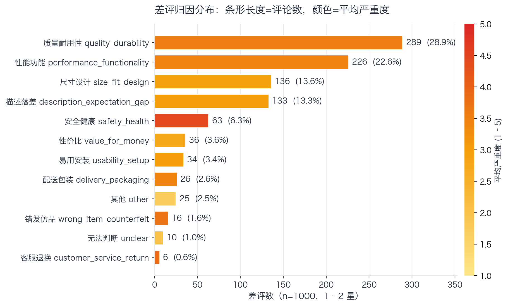
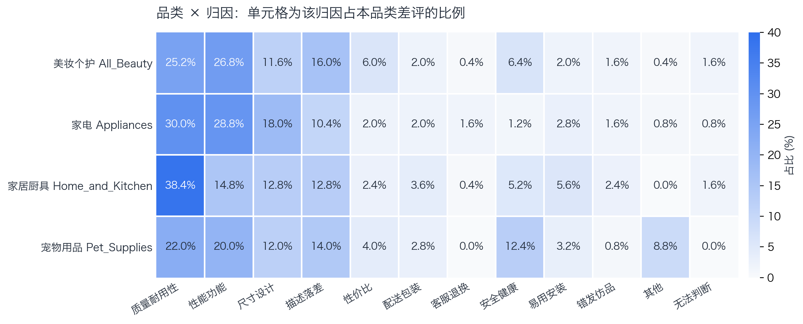
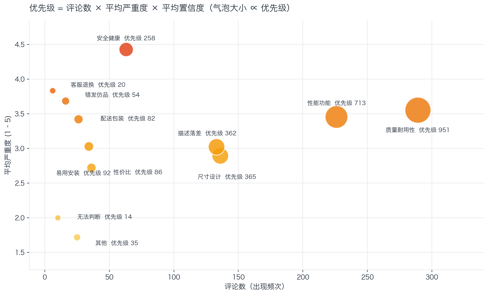

# 亚马逊差评文本挖掘与归因分析（LLM 辅助）

把 1,000 条 1–2 星差评，从"用户不满意"变成一份**可排序的改进清单**。

平台自带的评论标签只区分星级与"有用"投票，回答不了"为什么差"；通用情感分析只能给出正负面，落不到具体业务动作。本项目针对亚马逊美妆个护、家电、家居厨具、宠物用品 4 个品类，构建一套**闭环归因体系 + LLM 结构化标注 + 优先级排序**的方案，把非结构化差评转成可量化、可复现的归因数据。

## 结论速览

| 发现 | 数据支撑 |
| --- | --- |
| 差评高度集中在"做不好"而非"卖错" | 质量耐用性 28.9% + 性能功能 22.6% = **51.5%**，前四类原因占 78.4% |
| 品类痛点结构不同，不能套同一套改进策略 | 美妆个护首位原因是性能功能（26.8%）；家电、家居厨具、宠物用品首位均为质量耐用性（30.0% / 38.4% / 22.0%） |
| 安全健康是低频高风险项 | 仅占 6.3%，但平均严重度 **4.43**（全类别最高）；宠物用品达 12.4%，接近样本均值 2 倍 |
| 售后类抱怨在 1–2 星文本中几乎不成立 | 客服退换货 0.6%、发错货/仿品 1.6%，说明低星评论的主体是产品本身 |

优先级最高的三项（`评论数 × 平均严重度 × 平均置信度`）：质量耐用性 **950.6**、性能功能 **712.7**、尺寸设计 **364.7**。

## 数据

- 来源：Amazon Reviews 2023（McAuley Lab, UCSD），`raw_review_{All_Beauty, Appliances, Home_and_Kitchen, Pet_Supplies}` 四个品类。
- 抽样：每品类 250 条 1–2 星评论，共 1,000 条（1 星 616 / 2 星 384），流式读取、单品类扫描上限 30,000 行。
- 清洗：按 `parent_asin + 正文` 去重、剔除空白与 20 字符以下短文本、1,800 字符以上截断、统一空白字符。
- 处理量：扫描约 9,789 条原始评论 → 过滤 8,748 条非 1–2 星、41 条过短文本 → 保留 1,000 条（其中 17 条超长截断）。

## 方法

**1. 固定归因体系，先定标签再调模型。** 12 个互斥一级标签覆盖产品质量、体验、交易、服务四层，避免"同义词导致统计分裂"——这是关键词方案最容易失效的地方。

| 标签 | 含义 |
| --- | --- |
| `quality_durability` 质量耐用性 | 损坏、寿命短、做工与材质问题 |
| `performance_functionality` 性能功能 | 功能失效、性能不达标、兼容性问题 |
| `size_fit_design` 尺寸设计 | 尺寸、贴合度、人体工学、设计缺陷 |
| `description_expectation_gap` 描述落差 | 与页面描述、图片或预期不符 |
| `value_for_money` 性价比 | 价格、价值感不满 |
| `delivery_packaging` 配送包装 | 配送、缺件、包装受损 |
| `customer_service_return` 客服退换 | 客服、退换货、保修体验 |
| `safety_health` 安全健康 | 安全隐患、刺激、过敏或健康风险 |
| `usability_setup` 易用安装 | 安装、说明、易用性问题 |
| `wrong_item_counterfeit` 错发仿品 | 发错货、疑似仿品或二手品 |
| `other` 其他 | 有明确负面原因但不属于上述类别 |
| `unclear` 无法判断 | 证据不足 |

**2. 标准化 Prompt + 强约束输出。** 每条评论返回 `primary_cause`、最多 2 个 `secondary_causes`、`is_product_related`、`severity`(1–5)、`confidence`(0–1)、`evidence`(逐字摘录，不得编造)、`rationale`(中文简述)。用 `json_schema` 严格模式绑定标签枚举，`temperature=0`，10 条一批；客户端二次校验 review_id 集合完整性、主因不得重复为次因、分数区间合法，任一不过则重试整批。

**3. 两个打分维度。** `severity` 表示评论者描述的影响程度（1=轻微抱怨，3=实质不满，5=安全风险或完全不可用），`confidence` 表示文本证据是否充分。前者决定"该不该修"，后者决定"这条标签能不能信"。

**4. 自研优先级公式。**

```
priority = 评论数 × 平均严重度 × 平均置信度
```

用乘法而非加权求和，是为了让"高频 × 高危"自然放大（安全健康仅 63 条，因平均严重度 4.43 仍进入前五），同时让低置信度标签自动降权，避免噪声被规模放大。

## 结果

全量归因（n=1,000，按优先级排序，完整 CSV 见下文）：

| # | 归因 | 评论数 | 占比 | 平均严重度 | 平均置信度 | 优先级 |
| --- | --- | --- | --- | --- | --- | --- |
| 1 | quality_durability | 289 | 28.9% | 3.554 | 0.926 | 950.6 |
| 2 | performance_functionality | 226 | 22.6% | 3.456 | 0.913 | 712.7 |
| 3 | size_fit_design | 136 | 13.6% | 2.897 | 0.926 | 364.7 |
| 4 | description_expectation_gap | 133 | 13.3% | 3.023 | 0.899 | 361.6 |
| 5 | safety_health | 63 | 6.3% | 4.429 | 0.923 | 257.7 |
| 6 | usability_setup | 34 | 3.4% | 3.029 | 0.898 | 92.5 |
| 7 | value_for_money | 36 | 3.6% | 2.722 | 0.881 | 86.3 |
| 8 | delivery_packaging | 26 | 2.6% | 3.423 | 0.918 | 81.7 |
| 9 | wrong_item_counterfeit | 16 | 1.6% | 3.688 | 0.914 | 53.9 |
| 10 | other | 25 | 2.5% | 1.720 | 0.803 | 34.5 |
| 11 | customer_service_return | 6 | 0.6% | 3.833 | 0.875 | 20.1 |
| 12 | unclear | 10 | 1.0% | 2.000 | 0.725 | 14.5 |

品类 × 归因（每品类前三位）：

| 品类 | 差评数 | 首位 | 第二位 | 第三位 |
| --- | --- | --- | --- | --- |
| 美妆个护 All_Beauty | 250 | 性能功能 67（26.8%） | 质量耐用性 63（25.2%） | 描述落差 40（16.0%） |
| 家电 Appliances | 250 | 质量耐用性 75（30.0%） | 性能功能 72（28.8%） | 尺寸设计 45（18.0%） |
| 家居厨具 Home_and_Kitchen | 250 | 质量耐用性 96（38.4%） | 性能功能 37（14.8%） | 描述落差 32（12.8%） |
| 宠物用品 Pet_Supplies | 250 | 质量耐用性 55（22.0%） | 性能功能 50（20.0%） | 描述落差 35（14.0%） |

### 可视化

**图 1｜差评归因分布**：条形长度为评论数与占比，颜色深浅编码平均严重度——质量耐用性、性能功能量最大，而安全健康虽然只有 6.3%，颜色最深（平均严重度 4.43），是典型的"低频高危"项。



**图 2｜品类 × 归因热力图**：家电与家居厨具的质量耐用性占比（30.0%、38.4%）远高于美妆个护（25.2%）；美妆个护的性能功能（26.8%）是四品类中唯一的"功能优先"结构；宠物用品的安全健康（12.4%）接近样本均值 2 倍。



**图 3｜优先级气泡图**：X 轴为出现频次，Y 轴为平均严重度，气泡大小正比于优先级。右上方的质量耐用性、性能功能是"量大且痛"的改进首选；安全健康偏离主群，需要单独立项处理。



图表由 `scripts/visualize_results.py` 从标注结果自动生成：

```bash
python3 scripts/visualize_results.py \
  --labels outputs/amazon2023_1000/llm_labels.jsonl \
  --output-dir outputs/amazon2023_1000/report/figures
```

完整数值见 [`outputs/amazon2023_1000/report/report.md`](outputs/amazon2023_1000/report/report.md)，明细见同目录 `cause_summary.csv`、`category_cause_summary.csv`。每条标注示例见 [`samples/labeled_sample.jsonl`](samples/labeled_sample.jsonl)（12 类各 1 条）。

## 目录结构

```
.
├── scripts/
│   ├── prepare_amazon2023.py   # 流式抽样 + 清洗 → negative_reviews.jsonl
│   ├── classify_reviews.py     # LLM 批量标注，支持断点续跑
│   ├── summarize_causes.py     # 聚合、优先级计算、生成报告
│   └── visualize_results.py    # 结果可视化（分布 / 热力图 / 优先级气泡图）
├── src/review_mining/
│   ├── taxonomy.py             # 12 类标签 + JSON Schema
│   └── prompting.py            # Prompt 构建（与标签体系分离，便于评审与迭代）
├── samples/labeled_sample.jsonl
├── outputs/amazon2023_1000/
│   ├── processing_summary.json # 抽样与清洗统计
│   └── report/                 # 归因结果、报告与图表
└── requirements.txt
```

## 快速开始

```bash
python3 -m venv .venv && source .venv/bin/activate
pip install -r requirements.txt

export LLM_BASE_URL="https://dashscope.aliyuncs.com/compatible-mode/v1"
export LLM_API_KEY="你的 API Key"     # 或复制 .env.example 为 .env 本地填写
export LLM_MODEL="qwen3.7-flash"

# 1) 抽样与清洗
python3 scripts/prepare_amazon2023.py --per-category 250 \
  --output-dir outputs/amazon2023_1000 --trust-remote-code

# 2) LLM 批量归因（10 条/批，中断后重跑会自动跳过已完成记录）
python3 scripts/classify_reviews.py \
  --input outputs/amazon2023_1000/negative_reviews.jsonl \
  --output outputs/amazon2023_1000/llm_labels.jsonl \
  --batch-size 10 --limit 1000

# 3) 聚合与报告
python3 scripts/summarize_causes.py \
  --labels outputs/amazon2023_1000/llm_labels.jsonl \
  --output-dir outputs/amazon2023_1000/report

# 4) 可视化（生成 3 张图，可选）
python3 scripts/visualize_results.py \
  --labels outputs/amazon2023_1000/llm_labels.jsonl \
  --output-dir outputs/amazon2023_1000/report/figures
```

`classify_reviews.py` 需要服务端支持 `json_schema` 结构化输出（百炼、Ollama 等均可）；换模型时只需改 `LLM_MODEL`。数据下载缓存默认写入 `outputs/.hf_cache`，可用 `--cache-dir` 指定。

## 质量控制与已知局限

- **未完成人工金标准校验。** 当前结果未做分层抽样的准确率评估。下一步计划：从 12 类中各抽 8–10 条对照原文复核 `primary_cause` 与 `evidence`，记录准确率与常见混淆对（如"功能失效"与"质量耐用性"），再回写 Prompt 的反例。
- **置信度区分度有限。** 1,000 条平均 0.91，仅 2 条低于 0.6，说明 LLM 自评置信度偏保守乐观，只能当弱信号用，不能替代人工复核。
- **样本量限制下钻深度。** 每品类 250 条，可比较品类间结构差异，但不足以细分到子类目或品牌。
- **结论是"用户感知"而非产品事实。** 归因反映评论文本中的抱怨指向，不等于经检测确认的产品缺陷。
- **单一模型标注。** 未做跨模型一致性检验（同批跑两个模型并计算 Cohen's kappa 是可加的验证项）。
- **语种单一。** 本次样本全部为英文评论，多语言归因能力尚未验证。

## 数据许可

Amazon Reviews 2023 数据集仅允许学术研究使用，`product_id` 为匿名化 ID，不可关联个人信息，请在使用前确认用途合规。为遵守许可并控制仓库体积，本仓库**不包含全量原始评论文本**（`outputs/**/*.jsonl` 已在 `.gitignore` 中排除，可由脚本重新生成），仅保留聚合结果与 12 条示例。

## 参考

- Hou, Y. et al. *Bridging Language and Items for Retrieval and Recommendation* (Amazon Reviews 2023). https://huggingface.co/datasets/McAuley-Lab/Amazon-Reviews-2023
